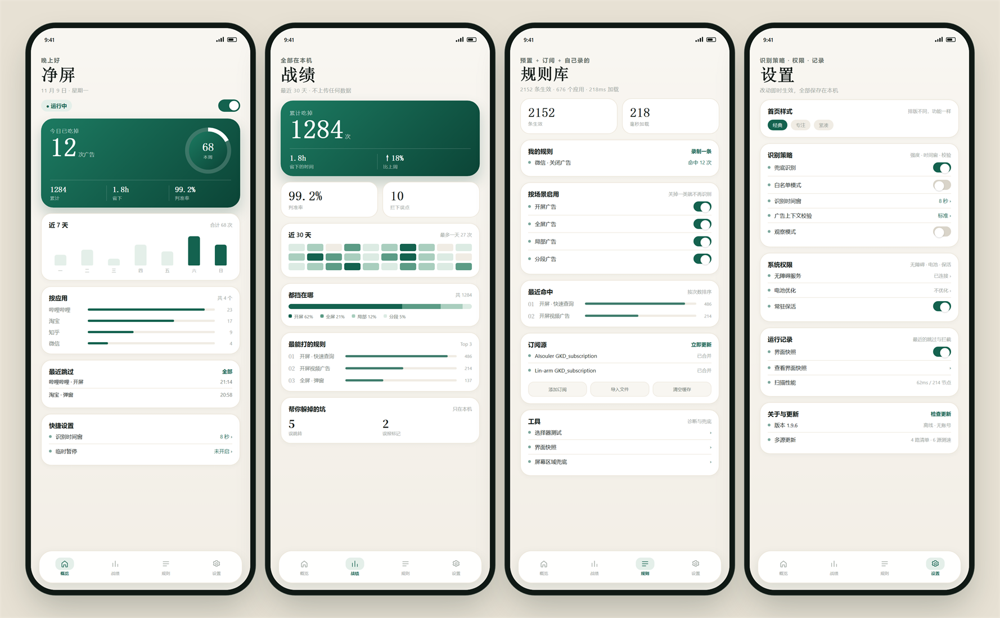

# 净屏

**开屏广告、弹窗广告，打开就没了。**

Android 7.0+ · 约 310 KB · 无账号 · 完全离线

 

<h2><a href="https://github.com/MY-moss/jingping/releases/latest">⬇️ 下载最新版</a></h2>

  

> 本仓库只发布 APK，**不包含源代码**。

## ✨ 特点

- **三 Tab 界面**：首页看「它在工作吗、今天挡了多少」，应用页管每个 App，我的页汇总战绩、规则、记录和设置；二级页有返回条和系统返回键
- **应用详情页**：点应用卡片进入完整页面，查看生效规则 / 累计跳过 / 分组数、最近跳过；规则可搜索、按组全开全关或逐条关闭
- **诊断页**：解释「为什么没跳过」：上一个应用与界面、页面可用规则、扫描耗时与节点数、上次跳过与最近拦截，并逐项检查无障碍 / 总开关 / 输入保护 / 时间窗 / 兜底 / 安全闸门
- **更新中心**：App 检查、镜像测速、下载、SHA-256 / 签名校验、安装状态集中一页；订阅按源记录上次成功时间，单个源失败不拖累其他源
- **约 3300 条生效规则**，覆盖 750 个应用；开屏 / 全屏 / 局部 / 分段四类场景独立开关
- **GKD 选择器引擎**：链式选择器、正则、多条件 AND、`vid`、`activityIds`、`preKeys` 多步规则全支持
- **完整动作支持**：点击、长按、返回、滑动（含 `swipeArg` 屏幕坐标表达式）
- **按应用调控**：搜索、全部 / 已适配 / 已关闭筛选、推荐 / 跳过最多 / 规则最多 / 名称排序；点卡片进入应用详情逐条管理
- **更快**：事件源子树增量扫描 + hint 倒排索引，开屏窗口内不再每个事件重建整棵节点树；带 `activityIds` 的规则只在对应界面参与匹配，常用 App 每个界面平均只查 6–8 条；应用页只创建屏幕上的十几行，滑动和搜索不再重建整页；冷启动只构建首页
- **反馈刚刚好**：半透明「angela吃掉了广告」气泡，可选短震
- **浅色 / 深色自动适配**：中性底、分组卡片、系统蓝与系统字体
- **更新不怕打断**：下载状态会保存，切后台、转屏或进程被回收后仍能继续校验并安装
- **轻量离线**：约 310 KB，无账号、无广告 SDK、不上传界面内容

## ⬇️ 安装

1. 下载最新的 `JingPing-*.apk`
2. 允许「安装未知来源应用」并安装
3. 打开净屏 → 开启无障碍服务
4. 建议顺手关闭电池优化，并在系统里允许自启动 / 后台运行

> Android 13+ 如果无障碍开关是灰的：应用信息 → 右上角三点 → 允许受限制的设置。

## 🔄 更新

- 我的 → 更新中心，检查新版、管理订阅、查看下载校验状态。
- 2.2.0 起改为事件源子树增量扫描 + hint 倒排索引，更新按订阅源记录成功时间；2.1.0 起新增应用详情页与诊断页，规则库 3345 条。
- 1.5.0 之前的版本没有更新检查，需要手动安装一次。

## ❓ 常见问题

**广告还会加载吗？**

会。净屏是「秒跳」：广告刚开始显示就被点掉，声音和画面基本来不及出现，但仍会消耗少量流量。想从源头拦截，可以配合私人 DNS（`dns.adguard-dns.com`）。

**无障碍被系统关掉了？**

我的 → 设置与权限 → 后台保活指南。净屏在被关闭时会发一条通知，点通知即可回来重新开启。

**不小心点错了？**

首页「最近跳过」或 我的 → 运行记录，看是哪条规则；再到 应用 页点进那个 App，单独关掉那一条。

**为什么某个 App 没有跳过？**

它可能没有专属规则，或规则被单独关闭。应用页顶部会显示已适配数量；点卡片能看这个 App 到底加载了哪些规则。也可以打开「诊断」：它会列出当前界面的可用规则、最近扫描和最近被安全闸门拦下的原因。

## 🔒 隐私

- 无账号、无统计、无上报
- 只读取当前界面的控件文字、描述和位置，用于匹配规则
- 日志只保存在本机，可随时清空
- 联网仅用于规则订阅和 GitHub 检查更新

## 📄 说明

个人自用工具，与任何应用或公司无关。规则来自社区公开订阅，请在遵守当地法律和应用条款的前提下使用。

---

如果它帮你省下了几秒钟，点个 ⭐ 就好。

